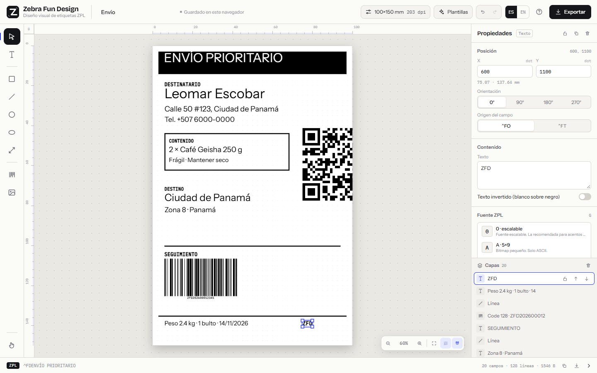
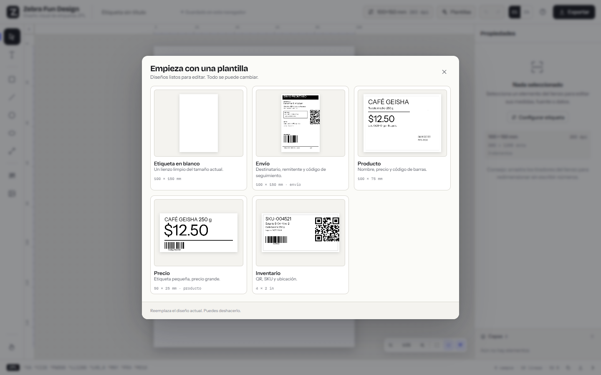
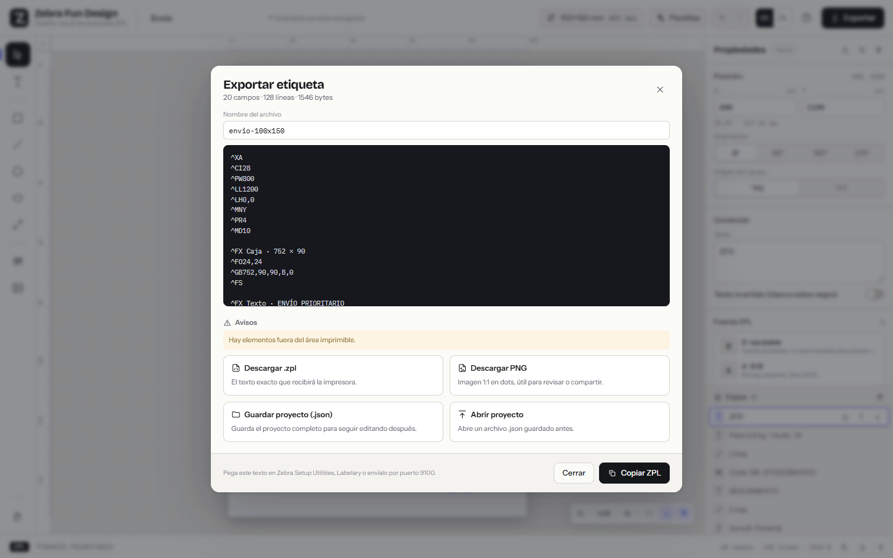
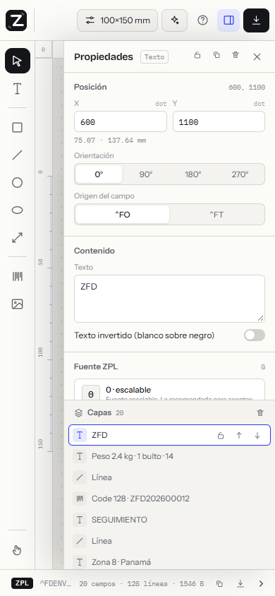

<p align="center">
  
</p>

<h1 align="center">Zebra Fun Design</h1>

<p align="center">
  <strong>Editor visual de etiquetas ZPL para impresoras Zebra</strong><br/>
  Diseña en el navegador como en Figma o Paint y exporta el código ZPL exacto<br/> que tu impresora recibe.
</p>

<p align="center">
  <a href="https://github.com/leomaresc/zebra-fun-design/blob/main/LICENSE"></a>
  
  
  
  
  
</p>



---

## Qué es

**Zebra Fun Design (ZFD)** es una aplicación web estática para diseñar etiquetas Zebra sin tocar código ZPL: eliges un formato, colocas texto, figuras, códigos de barras o imágenes y la app genera en tiempo real el comando `^XA … ^XZ` listo para imprimir (Zebra Setup Utilities, Labelary o el puerto 9100).

- **Sin backend ni cuentas** — todo se procesa y guarda en tu navegador (`localStorage`).
- **Sin instalación** — funciona desde cualquier subcarpeta estática o desde `file://` tras un build.
- **Fidelidad al manual ZPL** — el emisor se construyó contra el *ZPL II Programming Guide* de Zebra (1.769 páginas).

## Características

| | |
| --- | --- |
| 🎨 **Lienzo completo** | Zoom (Ctrl + rueda), paneo (Espacio + arrastrar), regla en mm, cuadrícula, snap a 10 dots, manejadores para redimensionar, selección marquee, alineación y distribución. |
| 🔤 **Texto real de Zebra** | Fuentes `0` (escalable) y `A`–`H` (bitmap) con sus métricas exactas, bloques `^FB` con ancho/líneas/espaciado/alineación/sangría, texto invertido `^FR`, origen `^FO`/`^FT` y rotación `N/R/I/B`. |
| 📊 **12 simbologías** | Code 128, Code 39, Code 93, EAN-13/8, UPC-A/E, ITF, Codabar, MSI, **QR Code** y **Data Matrix**, con vista previa real vía [bwip-js](https://github.com/bwip-js/bwip-js) y validación de datos. |
| 🖼️ **Imágenes a 1 bit** | PNG/JPG/WEBP/GIF con umbral, dither Floyd–Steinberg e invertir; se emiten como `^GFA` en hexadecimal, tal como espera la impresora. |
| 🧩 **5 plantillas** | En blanco, Envío, Producto, Precio e Inventario. Cambian el formato de la etiqueta y se pueden deshacer. |
| ↩️ **Edición cómoda** | Undo/redo agrupado por gesto, duplicar, copiar/pegar, capas con orden y bloqueo, flechas para mover 1 dot (Shift = 10). |
| 📦 **Documentos** | 8 presets de formato (100×150, 4×6", 50×25 mm…), DPI 203/300/600 con reescalado del diseño, medio `gap/continuous/mark`, velocidad, oscuridad y copias. |
| 🌐 **Bilingüe** | Interfaz completa en español e inglés; el idioma se recuerda. |

## Capturas

<table>
  <tr>
    <td width="50%"><strong>Plantillas listas para editar</strong><br/><br/></td>
    <td width="50%"><strong>Exportar: ZPL, PNG y proyecto JSON</strong><br/><br/></td>
  </tr>
</table>

<p align="center">
  <strong>Diseñado también para móvil</strong><br/><br/>
  
</p>

## Inicio rápido

```bash
git clone https://github.com/leomaresc/zebra-fun-design.git
cd zebra-fun-design
npm install
npm run dev        # http://localhost:5173
```

| Comando | Qué hace |
| --- | --- |
| `npm run dev` | Servidor de desarrollo con hot reload |
| `npm run build` | Compila TypeScript y genera `dist/` (assets con rutas relativas) |
| `npm run preview` | Sirve `dist/` en local para revisar el build |

> `dist/` usa `base: "./"`, así que puedes copiarlo a **cualquier subcarpeta** de un sitio estático, a Netlify o a GitHub Pages sin cambiar nada.

## Flujo de trabajo

1. **Formato** — abre *Plantillas* o *Configurar etiqueta* y elige el tamaño de tu rollo (100×150 mm, 4×6", 50×25 mm…).
2. **Dibuja** — añade texto, cajas, líneas, círculos, elipses, diagonales, códigos o arrastra una imagen al lienzo.
3. **Exporta** — *Copiar ZPL* para pegarlo en Zebra Setup Utilities / Labelary, descargar `.zpl`, exportar un PNG 1:1 o guardar el proyecto en `.json` para retomarlo después.

## Comandos ZPL que genera

| Elemento | Comandos emitidos |
| --- | --- |
| Cabecera | `^XA` `^CI28` `^PW` `^LL` `^LH0,0` `^MN` `^PR` `^MD` `^PQ` `^XZ` |
| Texto | `^FR` `^A0`/`^A{A–H}` `^FB` `^FH` `^FD` `^FS` |
| Figuras | `^GB` (caja/línea) · `^GC` (círculo) · `^GE` (elipse) · `^GD` (diagonal) |
| Barras 1D | `^BY` + `^BC` `^B3` `^BA` `^BE` `^B8` `^BU` `^B9` `^B2` `^BK` `^BM` |
| Códigos 2D | `^BQ{rot},2,{magnificación},{ecc},{mask}` · `^BX{rot},{módulo},200` |
| Imágenes | `^GFA,{bytes},{bytes},{bytesPorFila},` + filas hexadecimales |

Además gestiona los detalles delicados: `^CI28` UTF-8, escape hexadecimal con `^FH_` (`\`, `^`, `~`, `_`), saltos de línea como `\&`, UPC-E expandido a los 10 caracteres que exige `^B9`, y avisos de exportación (códigos inválidos, Unicode en fuentes bitmap, imágenes sin procesar, elementos fuera del área imprimible).

## Estructura

```
src/
├── App.tsx               # shell, atajos globales, modales, toasts
├── store.ts              # estado, historial (undo/redo) y persistencia
├── i18n.ts               # diccionario ES/EN
├── types.ts, factory.ts  # modelo del documento
├── components/           # TopBar · Toolrail · CanvasStage · Inspector · CodePanel · Modals
├── render/               # dibujo en canvas, hit-test, manejadores, procesado de imágenes
├── zpl/
│   ├── generate.ts       # emisor ZPL
│   ├── barcode.ts        # vista previa y validación con bwip-js
│   └── fonts.ts          # métricas reales de las fuentes de Zebra
├── data/templates.ts     # plantillas
└── assets/fonts/         # woff2 locales (sin CDN)
```

## Notas de fidelidad

- La vista previa **aproxima** fuentes y códigos: imprime una prueba antes de producción.
- Las fuentes `A`–`H` son bitmap y sólo cubren ASCII; para acentos o Unicode usa la fuente `0` (la app te avisa).
- Los códigos 2D se dibujan a su tamaño natural; la altura del elemento no los deforma.
- No hay impresión directa ni integración con impresoras: el alcance es **diseñar y exportar ZPL**.

## Requisitos

- Node.js 18+ sólo para desarrollar; el build final es HTML/CSS/JS estático.
- Navegador moderno (Chrome, Edge, Firefox, Safari).
- Única dependencia en tiempo de ejecución: `bwip-js`.

## Licencia

[MIT](LICENSE) © 2026 Leomar
